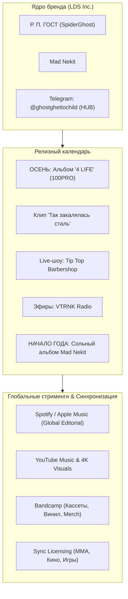

# BRAND BOOK & STRATEGIC EXPANSION HUB
## Р. П. ГОСТ / LA DAGON SECTOR INC. (@ghostghettochild)
**Affiliation: Лейбл 100PRO**

---

## 1. АРХИТЕКТУРА И ДНК БРЕНДА

### 1.1. Иерархия суббренда и позиционирование
* **Зонтичный бренд / Коллектив:** «Р. П. ГОСТ / La Dagon Sector Inc.» (LDS Inc.)
* **Цифровой хаб / Комьюнити-канал:** `@ghostghettochild` (Telegram — штаб-квартира смыслов, бэкстейджей, эксклюзива и связи с фан-базой).
* **Институциональная поддержка:** Лейбл **100PRO** (наследие Bad Balance, ШЕFF — знак качества классического, бескомпромиссного русскоязычного хип-хопа).
* **Ключевой ростер:**
  * **Р. П. ГОСТ (SpiderGhost)** — идеолог, фронтмен, визионер с самобытной подачей, уличной философией и многослойной лирикой.
  * **Mad Nekit** — ко-фаундер саунда, МС, битмейкер, сольный артист со своим предстоящим сольным релизом.
  * **LDS Squad** — продюсеры, гостевые МС, граффити-райтеры, визуальные художники андеграунда.

### 1.2. Метафора, Миссия и Ценности
* **Метафора бренда:** *«Так закалялась сталь»*. Это не гламурный поп-рэп однодневок — это закаленный индустриальной реальностью, шахтерским и уличным бэкграундом монолит. Музыка с характером, прошедшая огонь, воду и бетон.
* **Слоган / Клеймо:** *«4 LIFE»* (Закон братства, преданность стилю, музыка как жизненный путь, а не временный хайп).
* **Миссия:** Донести аутентичный, непричесанный, честный и поэтичный уличный рэп восточноевропейского андеграунда до мирового слушателя с качеством продакшна и визуальной упаковки уровня топовых мировых независимых объединений (уровня Griselda Records, Pro Era, Wu-Tang Clan legacy).

---

## 2. ВИЗУАЛЬНЫЙ И АТМОСФЕРНЫЙ КОД (IDENTITY & AESTHETICS)

```
[ ЦВЕТОВАЯ ПАЛИТРА ]
■ Raw Concrete (#222428) — База: индустриальный бетон, сумерки промзон
■ Dark Matte Obsidian (#0C0D0E) — Тьма, глубина ночного города, винил
■ Tempered Steel (#7A8288) — Закаленная сталь, холодные лезвия, микрофонные решетки
■ Oxide / Rust Red (#8B2500) — Ржавчина, искры плавильных печей, кровь улиц
■ Phosphor Green / VHS White (#E6ECE8) — Шум старых кинескопов, ночные маркеры
```

* **Визуальный стиль:**
  * Зернистость, пленочные текстуры 16mm/35mm, VHS-глитчи в умеренной дозировке.
  * Индустриальный минимализм, суровая эстетика брутализма, уличный реализм без дешевого лоска.
  * Локации: барбершопы (Tip Top Barbershop с винтажными креслами, хромом и кожей), радиостудии (ламповый полумрак VTRNK Radio), депо, мосты, крыши, гаражные боксы.
* **Шрифтовая система:**
  * *Заголовки:* Тяжелый, угловатый, индустриальный гротеск (шрифты в стиле Druk, Bebas Neue, Monument Extended, кириллический трафаретный брутализм).
  * *Субтитры / Манифесты:* Street-stencil, олдскульная печатная машинка, шелкография.

---

## 3. МЕДИА-ЭКОСИСТЕМА И ТЕКУЩИЙ РОАДМАП



1. **Флагманский дроп осени:** Командный лонгплей **«4 LIFE»** на 100PRO.
2. **Видео-манифест:** Официальный клип **«Так закалялась сталь»** (задает планку видео-продакшна).
3. **Оффлайн-триггер:** Камерное live-шоу в **Tip Top Barbershop** (создание атмосферного живого лайв-видеоформата).
4. **Медиа-поддержка:** Эфиры и фристайлы на **VTRNK Radio** (интервью, стримы, разбор треков).
5. **Стратегический эшелон:** Сольный альбом **Mad Nekit** в начале следующего года (масштабирование вселенной LDS).

---

## 4. СТРАТЕГИЯ ВЫХОДА НА МИРОВЫЕ ПЛОЩАДКИ

### 4.1. Анализ глобального рынка хип-хопа
* **Мировой тренд:** Возрождение интереса к «сырому» андеграунду, бум-бэпу 90-х и суровому аутентичному хип-хопу (успех Griselda Records — Westside Gunn, Conway The Machine, Benny The Butcher; Roc Marciano, Dope D.O.D., культовый статус Onyx).
* **Slavic / Eastern Hard Rap феномен:** Международная аудитория (США, Германия, Франция, Латинская Америка, Азия) ищет неподдельный восточноевропейский колорит — суровый бит, глубокий низкий голос, искренность и уличную романтику.

### 4.2. Платформы и инструменты глобальной дистрибуции
1. **Spotify & Apple Music Global:**
   * Питчинг в глобальные кураторские плейлисты: *Underground Rap, Beast Mode, Grime & Raw, Slavic Beats, Hip-Hop Heavyweights*.
   * Динамические холсты (Spotify Canvas) с фирменной мрачной эстетикой.
2. **YouTube & YouTube Music:**
   * Канал с 4K клипами, тайм-кодами, мультиязычными субтитрами (EN/ES/DE).
   * Лайв-сессии (формат Colors / Tiny Desk / From the Basement, но в суровом антураже Tip Top Barbershop).
3. **Bandcamp:**
   * Выпуск лимитированных кассет, винила и эксклюзивных инструменталов альбома «4 LIFE» для глобальных диггеров и коллекционеров винила.
4. **Синхронизация (Sync Licensing):**
   * Питчинг треков (в особенности «Так закалялась сталь») в саундтреки к видеоиграм, независимым фильмам/сериалам, промо-роликам единоборств (UFC, Hardcore, Top Dog, боксерские промоушены).

---

## 5. ВЗАИМНАЯ ВЫГОДА (WIN-WIN МОДЕЛЬ СОТРУДНИЧЕСТВА)

| Что получает «Р. П. ГОСТ / La Dagon Sector Inc.» | Что получаем МЫ (Продюсерско-технологический хаб) |
| :--- | :--- |
| **1. Технологический скачок без потери андер-духа:** Высокобюджетная упаковка, глобальный мастеринг, генеративная графика и видео. | **1. Эксклюзивный прецедент на рынке:** Флагманский кейс вывода нишевого андеграунд-коллектива на глобальные радары с помощью ИИ. |
| **2. Делегирование медиа-рутины:** Мы берем на себя автоматизацию контента, нарезку рилс/шортс, локализацию, питчинг и документацию. | **2. Rev-Share / Долевое участие:** Процент от прироста стриминга, монетизации YouTube, мерча, синхронизаций и концертных туров. |
| **3. Международный охват:** Англоязычные субтитры, адаптация смыслов (Genius Global), выход за рамки СНГ-рынка. | **3. Партнерство с легендарным лейблом 100PRO:** Прямой выход на экосистему Влада Валова и кросс-промо артистов лейбла. |
| **4. Систематизация релизов:** Четкая воронка (4 LIFE -> Клип -> Лайв -> VTRNK -> Сольник Mad Nekit). | **4. Построение долгосрочного медиа-актива:** Совместное владение создаваемыми цифровыми продуктами (шоу, мерч-линейки, спецпроекты). |

---

## 6. КАК МЫ МОЖЕМ ПОМОГАТЬ ИСПОЛЬЗУЯ ИИ (AI-ЭКОСИСТЕМА)

```
                              ┌─────────────────────────────────────────┐
                              │     AI ACCELERATOR ДЛЯ LDS INC.         │
                              └────────────────────┬────────────────────┘
                                                   │
         ┌─────────────────────────┬───────────────┴───────────────┬─────────────────────────┐
         │                         │                               │                         │
         ▼                         ▼                               ▼                         ▼
   [ АУДИО & ЗВУК ]         [ ВИЗУАЛ & КЛИПЫ ]            [ ЛОКАЛИЗАЦИЯ ]           [ SMM & ПИТЧИНГ ]
 • Stem Separation        • AI-визуалайзеры             • Перевод сленга (Genius) • Авто-нарезка шортс
 • Референс-мастеринг     • AI-генерация мизансцен      • AI-дубляж подкастов     • Персонализированный
 • Реставрация архивных     для клипа «Так закалялась     (VTRNK Radio на EN)       питчинг редакторам
   акапелл и лайвов         сталь» (Runway/Kling)       • Мультиязычные сабы        плейлистов
```

### 6.1. Аудио-продакшн и саунд-инжиниринг
* **AI Stem Separation & Sample Clearing:** Изоляция сэмплов, очистка раритетных виниловых лупов без артефактов (LALAL.AI / Ultimate Vocal Remover v5).
* **AI Mastering:** Адаптация треков под мировые LUFS-стандарты Spotify (-14 LUFS) и Apple Music Sound Check с сохранением жирного баса и панча бочки.
* **Восстановление архивного звука:** Очистка шумов с живых записей лайвов (Tip Top Barbershop, студийные фристайлы VTRNK).

### 6.2. Видео-продакшн и генеративный арт
* **Клип «Так закалялась сталь»:** Интеграция генеративных сцен (Runway Gen-3 Alpha, Kling AI, Midjourney v6) — постапокалиптические индустриальные цеха, плавящийся металл, символика Dagon Sector, сплетение с реальными съемками артистов.
* **Spotify Canvas & YouTube Visualizers:** Создание бесконечных лупов и анимированных обложек для каждого трека альбома «4 LIFE».
* **Апскейл и цветокоррекция:** Повышение качества сырых съемок с концертов и бэкстейджей до 4K/60fps (Topaz Video AI).

### 6.3. Глобализация и локализация контента
* **AI-перевод лирики и смысловой адаптации:** Создание подробных англоязычных аннотаций на Genius с расшифровкой метафор Горловки, уличных терминов и культурных кодов.
* **Локализация эфиров VTRNK Radio:** Клонирование голосов участников (ElevenLabs) для выпуска англоязычных хайлайтов и подкастов для зарубежных любителей восточноевропейского хип-хопа.

### 6.4. Автоматизация контент-машины и SMM
* **Штаб `@ghostghettochild`:** Контент-план с автоматической генерацией визуальных тизеров, аудио-сниппетов с бегущей звуковой волной и таймеров обратного отсчета.
* **Виральные шортс/рилс/тиктоки:** Автоматическая нарезка самых плотных панчей из клипа, лайва в Tip Top Barbershop и эфиров VTRNK (Opus Clip / Submagic) с динамическими стилизованными субтитрами.
* **A&R AI-аналитика и питчинг:** Анализ кураторов плейлистов в Spotify, генерация точечных питч-писем для редакторов и независимых блогеров.

---

## 7. ДОЛГОСРОЧНАЯ МОДЕЛЬ ВЗАИМОДЕЙСТВИЯ (ФАЗЫ РАЗВИТИЯ)

### Фаза 1 (Текущий квартал — Осень): Запуск альбома «4 LIFE» и клипа
* Финализация визуального пакета релиза «4 LIFE» (обложка, canvas, пресс-кит).
* Пре-продакшн и AI-усиление клипа «Так закалялась сталь».
* Упаковка Telegram-канала `@ghostghettochild` в единый медиа-хаб.

### Фаза 2 (Зима): Лайв-активация и медийный штурм
* Съемка и монтаж live-шоу в Tip Top Barbershop (оформление серии лайв-клипов).
* Упаковка эфиров на VTRNK Radio в серии вертикальных шортс/подкастов.
* Дроп лимитированного мерча и кассет/винила через предзаказы.

### Фаза 3 (Начало года): Сольный альбом Mad Nekit
* Старт промо-кампании сольника Mad Nekit.
* Кросс-промо через аудиторию «4 LIFE» и лейбл 100PRO.
* Выход на зарубежные хип-хоп блоги и плейлисты с эксклюзивными премьерами.

### Фаза 4 (Долгосрочно): Музыкально-технологический синдикат
* Превращение La Dagon Sector Inc. в автономный музыкальный бренд с международной дистрибуцией.
* Заключение эксклюзивных контрактов на синхронизацию (кино, игры, промоушены единоборств).
