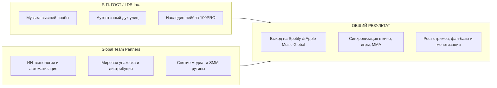

# 🌐 GLOBAL TEAM PARTNERS × Р. П. ГОСТ / LA DAGON SECTOR INC.
### Официальный цифровой хаб совместного развития и глобального продвижения

---

## 📌 О ПРОЕКТЕ И ЭТОМ ХАБЕ

Этот репозиторий — **единый прозрачный командный центр** партнерства между **Global Team Partners** и объединением **«Р. П. ГОСТ / La Dagon Sector Inc.»** (артисты легендарного хип-хоп лейбла **100PRO**).

Здесь фиксируется **каждый шаг нашего совместного движения**, статус текущих релизов, план действий, технические задачи и аналитика результатов. 

> **Для кого этот хаб:**
> 1. **Для Нас (Global Team Partners):** Место, где мы ведем процесс, ставим задачи, логируем прогресс, добавляем ссылки на готовые ассеты и метрики.
> 2. **Для Артиста (Р. П. ГОСТ, Mad Nekit, LDS Inc.):** Открытая витрина, куда можно зайти в любой момент с телефона или компьютера и видеть: *что сейчас делается, что сделано, какой следующий шаг, когда дроп и какие цифры мы получаем*.

---

## ⚡ ТЕКУЩИЙ СТАТУС И ГЛАВНЫЕ ФОКУСЫ

| Этап / Релиз | Таймлайн | Статус | Фокусная задача |
| :--- | :--- | :---: | :--- |
| **Командный альбом «4 LIFE»** | Осень | 🟡 В работе | Подготовка к релизу на 100PRO, питчинг в плейлисты, Spotify Canvas |
| **Клип «Так закалялась сталь»** | Осень | 🟡 В работе | AI-генерация индустриальных мизансцен, цветокоррекция, мультиязычные сабы |
| **Live-шоу в Tip Top Barbershop** | Осень / Зима | ⚪ Запланировано | Съемка камерного лайва, монтаж атмосферных видео-сессий |
| **Эфиры на VTRNK Radio** | Постоянно | 🟢 На связи | Нарезка виральных шортс/рилс с панчами, AI-дубляж ключевых мыслей |
| **Сольный альбом Mad Nekit** | Начало года | ⚪ В плане | Разработка стратегии промо, тизер-кампания, сэмпл-паки |

---

## 🧭 БЫСТРАЯ НАВИГАЦИЯ ПО РАЗДЕЛАМ

* 📋 **[Пошаговый план действий (Что мы делаем)](docs/ACTION_PLAN.md)** — детальный перечень работ от пре-продакшна до мировых стримингов.
* 🤝 **[Манифест взаимной выгоды (Win-Win)](docs/WIN_WIN.md)** — прозрачный расклад: выгода для артиста, для нас и общая синергия.
* 🗺️ **[Календарный роадмап и трекер задач](docs/ROADMAP.md)** — интерактивный чек-лист с фазами, дедлайнами и ответственными.
* 🤖 **[AI-инструментарий и технологии](docs/AI_STACK.md)** — как ИИ ускоряет саунд, видео, локализацию и SMM без потери андерграундного духа.
* 📝 **[Журнал обновлений и лог движения](docs/PROGRESS_LOG.md)** — хроника всех действий, встреч, загрузок материалов и результатов.
* 🎨 **[Брендбук и визуальный стиль](docs/BRANDBOOK.md)** — цветовой код, смыслы, философия «Так закалялась сталь» и шрифты.

---

## 🎯 СУТЬ И ВЗАИМНАЯ ВЫГОДА (КРАТКО)

* **Артист не тратит время на рутину:** Нарезку сотен рилсов, составление питч-деков для редакторов плейлистов, перевод текстов и оформление графики мы берем на себя.
* **Мы получаем сильный бренд и долю в успехе:** Работаем по прозрачной модели Rev-Share (процент от прироста стриминга, мерча и синхронизаций), создавая мировой кейс для андеграунд-музыки.
* **Основа отношений:** Полное взаимное доверие, прозрачность в этом репозитории и сохранение 100% творческой независимости артиста.

---

## 📱 КАК ВНОСИТЬ ИЗМЕНЕНИЯ И СЛЕДИТЬ ЗА ДВИЖЕНИЕМ

1. **Для Global Team Partners:**
   * Добавляйте новые выполненные задачи и ссылки в `docs/PROGRESS_LOG.md`.
   * Обновляйте статус в таблицах роадмапа (`docs/ROADMAP.md`).
2. **Для команды Р. П. ГОСТ / Mad Nekit:**
   * Открывайте вкладку **[Журнал движения](docs/PROGRESS_LOG.md)**, чтобы видеть свежие новости.
   * Ссылки на готовые файлы, промо-материалы и видео всегда доступны в соответствующих разделах.

---
*Связано с Telegram-каналом: [@ghostghettochild](https://t.me/ghostghettochild) • Лейбл: 100PRO*